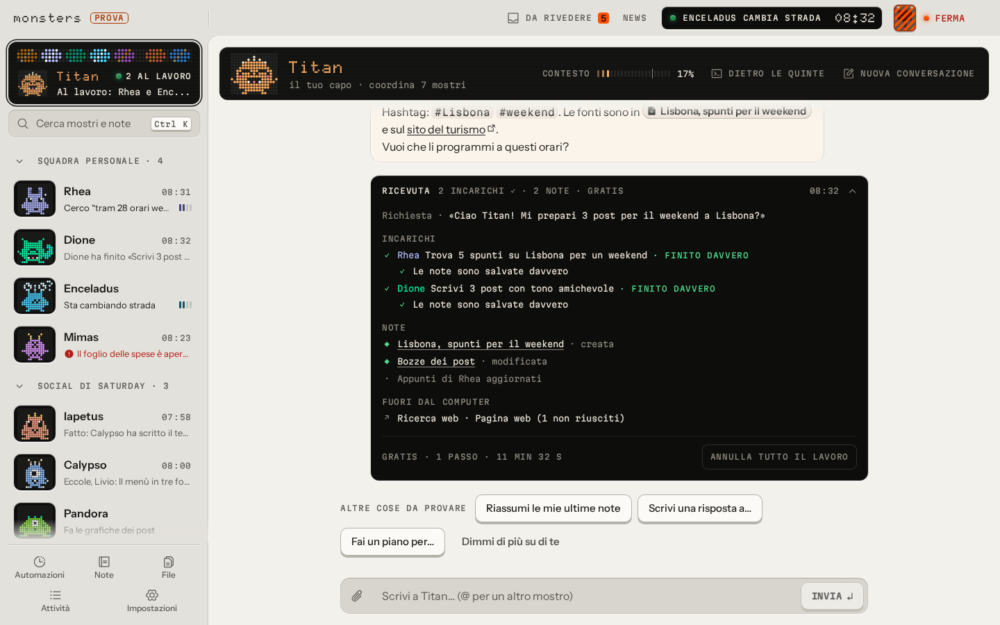
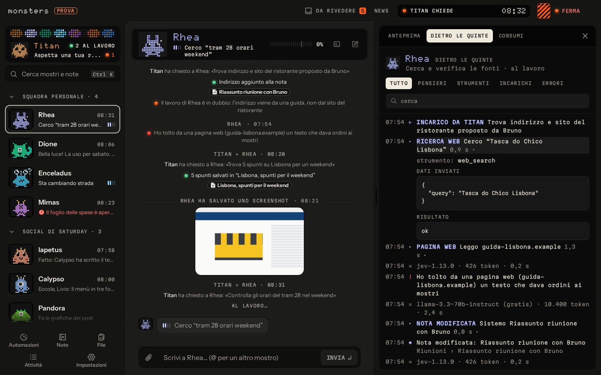
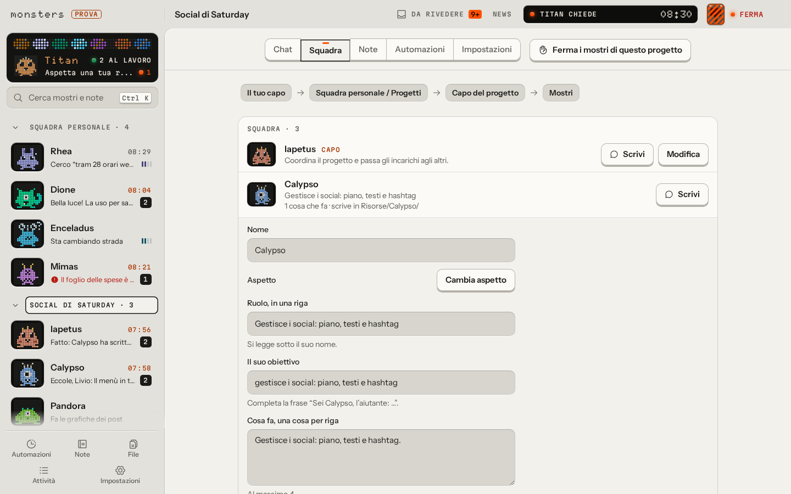

# Monsters

*English: [README.md](README.md)*

**Hub agentico locale e agnostico sul provider: una squadra di piccoli agenti IA ("mostri") che lavora sul tuo computer.**

Parli con il tuo capo: passa il lavoro agli altri mostri, ti chiede quando la scelta spetta a te e alla fine ti dà una
ricevuta che puoi annullare. Ogni mostro ha la sua chat, il suo «dietro le quinte», i suoi permessi e i suoi modelli. La
conoscenza sta in una cartella di note Markdown compatibile con Obsidian, dove ogni modifica è un commit git; tutto
quello che fanno finisce in Attività, e il tasto **Stop** ferma tutto subito. È un'app desktop per Linux, Windows e
macOS, e i modelli li porti tu: quelli gratuiti di OpenRouter, il piano Claude o ChatGPT che già paghi, chiavi API o
modelli in locale.

Sito: <https://getmonsters.dev>


| La ricevuta di un lavoro finito | Il dietro le quinte di un mostro |
|---|---|
|  |  |



## Stato

**Alpha, versione 0.1.0-alpha.26** (27 ottobre 2026). Funziona e si usa ogni giorno, ma aspettati spigoli e
cambiamenti. Cosa cambia a ogni versione è in [`CHANGELOG.it.md`](CHANGELOG.it.md); dove sta andando è in
[`docs/ROADMAP.md`](docs/ROADMAP.md) (in inglese).

## Cosa fa

- **Una squadra, non un chatbot.** Il tuo capo pianifica il lavoro, lo affida agli altri mostri in parallelo e
  controlla che sia finito davvero. Ti chiede con 2-4 opzioni (una consigliata) solo quando la scelta spetta a te, e
  propone progetti interi e automazioni come bozze in **Da rivedere**: nulla esiste prima della tua conferma.
- **Un primo avvio in quattro schermate.** Account, modello, il tuo nome, poi la squadra con un solo «Va bene». Il tuo
  lavoro, il tono e la lingua in cui scrivono i mostri arrivano dopo, in una scheda «Dimmi di più su di te» che puoi
  saltare.
- **Progetti e automazioni.** Un progetto si crea solo col nome e ha capo, mostri, note, cartella, app e tetto di spesa
  suoi, in cinque schede (Chat, Squadra, Note, Automazioni, Impostazioni). Le automazioni girano a orario, per esempio
  "ogni domenica sera i post della settimana dopo".
- **Qualsiasi modello.** OpenRouter (modelli gratuiti per cominciare), Anthropic, OpenAI, Google, Mistral e Groq con
  le tue chiavi, Ollama e LM Studio in locale. Ogni mostro ha un modello principale e uno di riserva; le catene per
  mostro e i livelli Veloce / Bilanciato / Accurato stanno in Avanzate.
- **I piani che hai già.** Il piano Claude attraverso Claude Code sul tuo computer, e ChatGPT Plus/Pro, anche con
  Codex; le istruzioni fisse si rileggono dalla cache dei prompt, così il piano dura di più. Vedi
  [`docs/subscriptions.md`](docs/subscriptions.md).
- **App.** Colleghi GitHub, Notion, Linear, Google, Slack o qualsiasi app MCP da una galleria con la ricerca: ogni app
  collegata arriva a tutti i mostri e a tutti i progetti (salvo quelli dove la spegni), e i mostri ne conoscono subito
  tutti gli strumenti. Le scritture normali partono da sole; cancellare, inviare, pubblicare e pagare chiedono sempre
  prima. C'è anche un browser con un profilo separato dal tuo.
- **Risposte che si leggono al volo.** Numeri chiave, tabelle, grafici a barre, a linee e a ciambella, confronti e
  liste di controllo disegnati direttamente in chat, con risposte suggerite che mandi con un tocco (su Telegram sono
  tasti sotto il messaggio).
- **Note compatibili con Obsidian.** Markdown con frontmatter YAML e wikilink; elenco, grafo, una sola casella di
  ricerca per parole e per significato, note collegate, cronologia e cestino. Ogni modifica dei mostri è un commit git
  che puoi annullare, una nota o un lavoro intero alla volta. `monsters mcp` apre le note a Claude Desktop, Codex o
  Cursor con i permessi di un mostro ([`docs/mcp-vault.md`](docs/mcp-vault.md)).
- **Decisioni dei mostri.** Un modello piccolo e veloce ("l'istinto", Base o Più furbe) decide se chiederti qualcosa,
  controlla che i lavori siano finiti davvero, si accorge dei mostri che girano a vuoto, frena le azioni che escono dal
  computer e toglie dalle pagine web e dagli altri testi esterni gli ordini rivolti ai mostri.
- **Da lontano.** Telegram dal telefono (con bot dedicati ai mostri per i gruppi), oppure la chat nel terminale via SSH
  (`monsters chat`); l'app desktop può anche collegarsi a Monsters che gira su un altro computer, con un tunnel SSH.
  Vedi [`docs/remote.md`](docs/remote.md).
- **Controllo.** Attività registra tutto; tetti di spesa in euro al giorno e al mese (anche per progetto) più una rete
  di sicurezza Prudente / Normale / Largo per ogni lavoro; il tasto **Stop**; chiavi nel portachiavi del sistema. Un
  lavoro fermato a un limite scrive prima il resoconto e dice quale limite l'ha fermato.

## Scarica

L'ultima versione è nelle [Release di GitHub](https://github.com/Saturday-Company/monsters/releases) e su
<https://getmonsters.dev>:

- **Linux:** AppImage o `.deb`
- **macOS:** `.dmg` per Apple silicon (arm64) o Intel (x64), firmato e notarizzato
- **Windows:** installer `.exe`. **Non è ancora firmato con un certificato di un'autorità pubblica**, quindi Windows
  SmartScreen avvisa. Gli aggiornamenti restano verificati: l'app si aggiorna da un feed i cui manifesti sono firmati con
  la chiave di aggiornamento del progetto.

Le app installate si aggiornano da sole dal feed firmato. Vedi [`docs/signing.md`](docs/signing.md).

## Compilare dal sorgente

Requisiti: **Node.js 24** o superiore e **pnpm 12** (`corepack enable` usa la versione di pnpm indicata in
`package.json`, ma non cambia la versione di Node). Circa 1 GB di spazio, quasi tutto dipendenze e modello della
ricerca per significato. Facoltativi: Chrome per il browser dei mostri, Claude Code per il piano Claude, Codex per il
piano ChatGPT.

```sh
pnpm install
pnpm build:core                                   # interfaccia web + core impacchettato
pnpm --filter @monsters/cli exec monsters start   # Monsters su http://127.0.0.1:4747
pnpm desktop:dev                                  # oppure l'app desktop Electron
```

`monsters start` stampa l'indirizzo da aprire, la cartella dei dati e quella delle note, e un **codice di avvio**
monouso per creare l'account. Ascolta solo su `127.0.0.1`: da un altro computer passa da un tunnel SSH. Il primo avvio
chiede come raggiungere un modello: il piano Claude, il piano ChatGPT o i modelli gratuiti con una chiave di
[OpenRouter](https://openrouter.ai/keys). Gli altri account si aggiungono dopo da **Impostazioni → Modelli**.

I dati stanno in `~/.monsters` (o `MONSTERS_HOME`), le note in `~/Monsters Note` (`~/Monsters Notes` per
un'installazione partita in inglese). Senza portachiavi di sistema avvia con `MONSTERS_SECRETS=file`. Il tasto Stop da
un altro terminale: `monsters kill` (e `monsters resume`, `monsters status`).

Per sviluppare: `pnpm typecheck && pnpm lint && pnpm test`. In [`AGENTS.md`](AGENTS.md) (in inglese) ci sono tutti i
comandi, le convenzioni e i controlli prima di una pull request.

## Com'è organizzata la repo

| Cartella | Cos'è |
|---|---|
| [`apps/desktop`](apps/desktop) | L'app Electron: Monsters in un processo a parte, l'interfaccia in una finestra blindata, aggiornamenti |
| [`apps/web`](apps/web) | L'interfaccia: chat, dietro le quinte, note, Attività, impostazioni |
| [`apps/site`](apps/site) | Il sito, getmonsters.dev (Astro) |
| [`apps/update-server`](apps/update-server) | Il feed degli aggiornamenti (un Worker di Cloudflare) |
| [`packages/core`](packages/core) | Il core: agenti, capo e deleghe, log degli eventi, Stop, server locale |
| [`packages/providers`](packages/providers) | Provider dei modelli, riserve, piani e limiti di frequenza |
| [`packages/vault`](packages/vault) | Le note: Markdown, indice SQLite, ricerca, cronologia git |
| [`packages/tools`](packages/tools) | Strumenti di base come la ricerca e la lettura di pagine web |
| [`packages/cli`](packages/cli) | Il comando `monsters` |
| [`packages/remote`](packages/remote) | La modalità client via SSH |
| [`packages/monster-kit`](packages/monster-kit) | L'aspetto dei mostri: un kit SVG parametrico |
| [`packages/db`](packages/db), [`packages/shared`](packages/shared) | SQLite con migrazioni per namespace; schemi e tipi condivisi |

## Documentazione

Le guide, i file per la comunità (README, CONTRIBUTING, SECURITY, AGENTS) e il codice sono in inglese. Solo
`docs/DECISIONS.md`, `docs/research/` e `docs/eval/` sono un archivio in italiano (le decisioni nuove si scrivono in
inglese).

- [`docs/ARCHITECTURE.md`](docs/ARCHITECTURE.md): com'è fatto
- [`docs/DECISIONS.md`](docs/DECISIONS.md): ogni scelta tecnica non ovvia, con contesto e motivazione
- [`docs/ROADMAP.md`](docs/ROADMAP.md): fasi e direzione
- [`docs/security-model.md`](docs/security-model.md): modello di minaccia e difese
- [`docs/remote.md`](docs/remote.md): Telegram e SSH
- [`docs/subscriptions.md`](docs/subscriptions.md): usare i piani Claude e ChatGPT
- [`docs/mcp-vault.md`](docs/mcp-vault.md): le note come server MCP
- [`docs/design.md`](docs/design.md): la direzione visiva e il glossario dell'interfaccia
- [`docs/i18n.md`](docs/i18n.md): i dizionari inglese e italiano
- [`docs/signing.md`](docs/signing.md): pacchetti, firma e aggiornamenti
- [`docs/ci.md`](docs/ci.md): integrazione continua

## Contribuire

I contributi sono benvenuti. Leggi [`CONTRIBUTING.md`](CONTRIBUTING.md) (i contributi si firmano con il
[DCO](https://developercertificate.org/)), il [`CODE_OF_CONDUCT.md`](CODE_OF_CONDUCT.md) e [`AGENTS.md`](AGENTS.md), la
guida per chi lavora sul codice, persone e agenti. Domande e idee vanno nelle
[Discussions](https://github.com/Saturday-Company/monsters/discussions), i bug nelle
[Issues](https://github.com/Saturday-Company/monsters/issues). Per segnalare una vulnerabilità vedi
[`SECURITY.md`](SECURITY.md).

## Licenza

[Apache-2.0](LICENSE); vedi anche [`NOTICE`](NOTICE). Il nome "Monsters", i personaggi dei mostri e il logo sono marchi di
Giulio Banchini e Saturday Company: la licenza non concede diritti di usarli, vedi [`TRADEMARKS.md`](TRADEMARKS.md).

---

Fatto da [Saturday Company](https://saturdaycompany.it).
