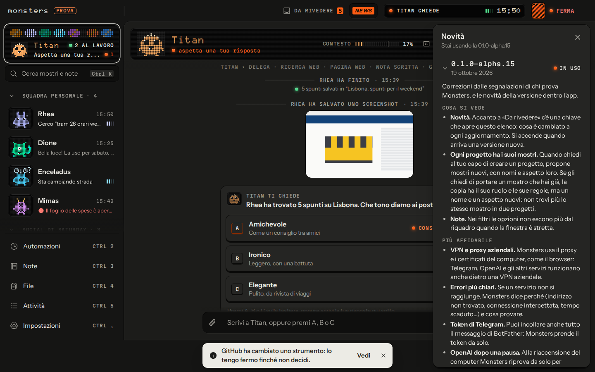

# Monsters

*English: [README.md](README.md)*

**Hub agentico locale e agnostico sul provider: una squadra di piccoli agenti IA ("mostri") che lavora sul tuo computer.**

Monsters ti dà un orchestratore e una squadra di agenti, ciascuno con la sua chat, il suo terminale, i suoi permessi e
la sua catena di modelli. La conoscenza sta in un vault Markdown compatibile con Obsidian, dove ogni modifica è un commit
git che puoi annullare, e tutto quello che fanno finisce nel log delle azioni. Un kill switch (**Ferma**) blocca tutto
subito. È un'app desktop per Linux, Windows e macOS, e i modelli li porti tu: OpenRouter, chiavi API, modelli locali o
gli abbonamenti che già paghi.

Sito: <https://getmonsters.dev>


| Chat con domanda e opzioni | Terminale di un agente |
|---|---|
|  |  |



## Stato

**Alpha, versione 0.1.0-alpha.18.** Funziona e si usa ogni giorno, ma aspettati spigoli e cambiamenti. Vedi
[`CHANGELOG.md`](CHANGELOG.md) e [`docs/ROADMAP.md`](docs/ROADMAP.md) (in inglese).

## Cosa fa

- **Una squadra di agenti.** Una chat e un terminale per ogni mostro; un orchestratore (il "Dio dei mostri") che propone
  progetti interi e automazioni come bozze in **Da rivedere**: nulla esiste prima del tuo tocco su Conferma.
- **Progetti e automazioni.** Squadre dedicate con capo, mostri propri, area del vault, cartella, collegamenti e tetto
  di spesa; automazioni pianificate, per esempio "ogni domenica sera i post della settimana dopo".
- **Qualsiasi modello.** OpenRouter (gratuito per cominciare), Anthropic, OpenAI, Google, Mistral e Groq con le tue
  chiavi, Ollama e LM Studio in locale. Ogni mostro ha la sua catena di modelli, con ripiego se uno non risponde.
- **Gli abbonamenti che hai già.** Claude Agent (Claude Code sul tuo PC) e ChatGPT Plus/Pro, anche con Codex. Vedi
  [`docs/subscriptions.md`](docs/subscriptions.md).
- **Strumenti esterni.** Server MCP a tua scelta e un browser con un profilo separato dal tuo. Terminale e file sono
  spenti di default: li dai tu, mostro per mostro.
- **Vault compatibile con Obsidian.** Markdown con frontmatter YAML e wikilink; elenco, grafo, ricerca per parole e per
  significato, note collegate, cronologia e cestino. Ogni modifica dei mostri è un commit git, annullabile dal log.
  `monsters mcp` apre il vault a Claude Desktop, Codex o Cursor con i permessi di un mostro
  ([`docs/mcp-vault.md`](docs/mcp-vault.md)).
- **Istinto.** Un modello piccolo e veloce decide se chiederti qualcosa, controlla che i lavori siano finiti davvero, si
  accorge di chi gira a vuoto, frena le azioni che escono dal computer e toglie dai testi esterni gli ordini rivolti ai
  mostri. A fine lavoro c'è una ricevuta con "Annulla tutto il lavoro".
- **Da lontano.** Telegram dal telefono (anche con un bot dedicato per mostro), oppure la chat nel terminale via SSH
  (`monsters chat`); l'app desktop può anche collegarsi come client a un core che gira altrove, con un tunnel SSH. Vedi
  [`docs/remote.md`](docs/remote.md).
- **Controllo.** Log di ogni azione, tetti di spesa al giorno e al mese (anche per progetto), kill switch **Ferma**,
  segreti nel portachiavi del sistema.

## Scarica

L'ultima versione è nelle [Release di GitHub](https://github.com/Saturday-Company/monsters/releases):

- **Linux:** AppImage o `.deb`
- **macOS:** `.dmg` per Apple silicon (arm64) o Intel (x64)
- **Windows:** installer `.exe`. **Non è ancora firmato con un certificato di un'autorità pubblica**, quindi Windows
  SmartScreen avvisa. Gli aggiornamenti restano verificati: l'app si aggiorna da un feed i cui manifesti sono firmati con
  la chiave di aggiornamento del progetto.

Le app installate si aggiornano da sole dal feed firmato. Vedi [`docs/signing.md`](docs/signing.md).

## Compilare dal sorgente

Requisiti: **Node.js 24** o superiore (`corepack enable` attiva pnpm ma non cambia la versione di Node) e **pnpm 12**
(`corepack enable` usa la versione indicata in `package.json`). Circa 1 GB di spazio, quasi tutto dipendenze e modello
della ricerca per significato. Facoltativi: Chrome per il browser dei mostri, Claude Code per Claude Agent.

```sh
pnpm install
pnpm build:core                                   # interfaccia web + core impacchettato
pnpm --filter @monsters/cli exec monsters start   # core su http://127.0.0.1:4747
pnpm desktop:dev                                  # oppure l'app desktop Electron
```

`monsters start` stampa l'indirizzo da aprire, la cartella dei dati e quella del vault, e un **codice di avvio** monouso
per creare l'account. Il core ascolta solo su `127.0.0.1`: da un altro computer passa da un tunnel SSH. L'onboarding
chiede una chiave di [OpenRouter](https://openrouter.ai/keys) (ne basta una gratuita); gli altri provider si aggiungono
dopo da **Impostazioni → Modelli**.

I dati stanno in `~/.monsters` (o `MONSTERS_HOME`), il vault in `~/Monsters Note`. Senza portachiavi di sistema avvia con
`MONSTERS_SECRETS=file`. Kill switch da un altro terminale: `monsters kill` (e `monsters resume`, `monsters status`).

Per sviluppare: `pnpm typecheck && pnpm lint && pnpm test`. Tutti i comandi sono in [`AGENTS.md`](AGENTS.md) (in inglese).

## Documentazione

Le guide, i file per la comunità (README, CONTRIBUTING, SECURITY, AGENTS) e il codice sono in inglese. Solo
`docs/DECISIONS.md`, `docs/research/` e `docs/eval/` sono un archivio in italiano (le decisioni nuove si scrivono in
inglese).

- [`docs/ARCHITECTURE.md`](docs/ARCHITECTURE.md): com'è fatto
- [`docs/DECISIONS.md`](docs/DECISIONS.md): ogni scelta tecnica non ovvia, con contesto e motivazione
- [`docs/ROADMAP.md`](docs/ROADMAP.md): fasi e direzione
- [`docs/security-model.md`](docs/security-model.md): modello di minaccia e difese
- [`docs/remote.md`](docs/remote.md): Telegram e SSH
- [`docs/subscriptions.md`](docs/subscriptions.md): usare gli abbonamenti Claude e ChatGPT
- [`docs/mcp-vault.md`](docs/mcp-vault.md): il vault come server MCP
- [`docs/signing.md`](docs/signing.md): pacchetti, firma e aggiornamenti
- [`docs/ci.md`](docs/ci.md): integrazione continua

## Contribuire

I contributi sono benvenuti. Leggi [`CONTRIBUTING.md`](CONTRIBUTING.md) (i contributi si firmano con il
[DCO](https://developercertificate.org/)), il [`CODE_OF_CONDUCT.md`](CODE_OF_CONDUCT.md) e [`AGENTS.md`](AGENTS.md), la
guida per chi lavora sul codice, persone e agenti. Per segnalare una vulnerabilità vedi [`SECURITY.md`](SECURITY.md).

## Licenza

[Apache-2.0](LICENSE); vedi anche [`NOTICE`](NOTICE). Il nome "Monsters", i personaggi dei mostri e il logo sono marchi di
Giulio Banchini e Saturday Company: la licenza non concede diritti di usarli, vedi [`TRADEMARKS.md`](TRADEMARKS.md).

---

Fatto da [Saturday Company](https://saturdaycompany.it).
