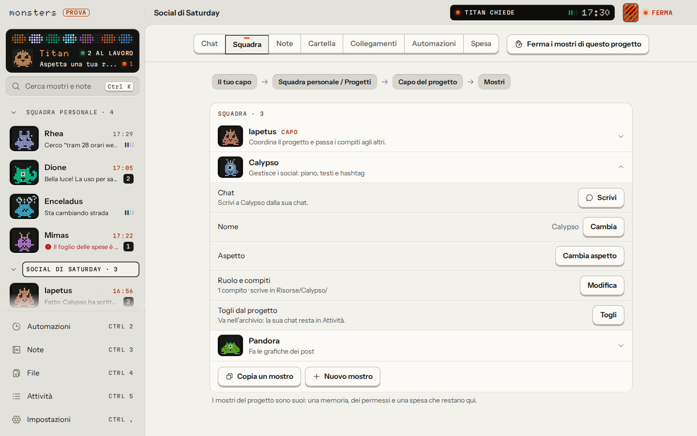
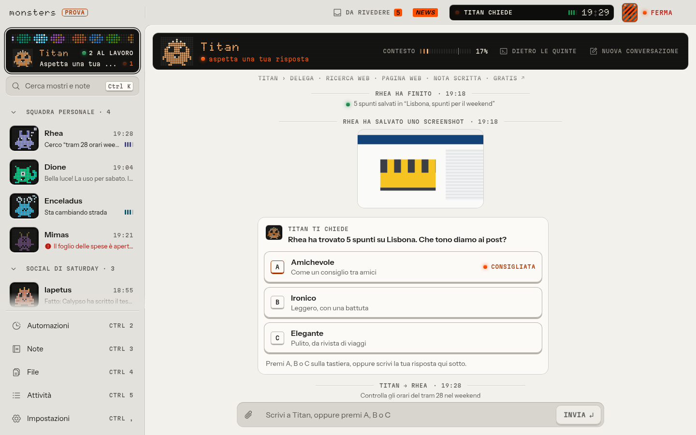
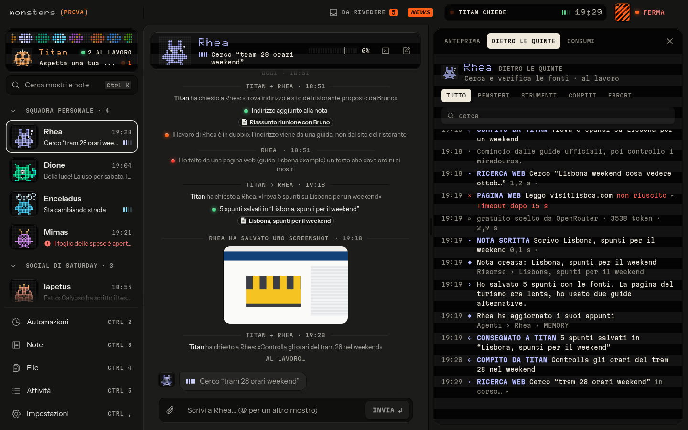

# Monsters

*Italiano: [README.it.md](README.it.md)*

**A local-first, provider-agnostic agentic hub: a team of small AI agents ("monsters") that work on your own computer.**

Monsters gives you an orchestrator and a team of agents, each with its own chat, terminal, permissions and model chain.
They keep their knowledge in an Obsidian-compatible Markdown vault where every change is a git commit you can undo,
and everything they do lands in an action log. A kill switch (**Ferma**, "stop") halts all work at once. It runs as a
desktop app on Linux, Windows and macOS, and you bring your own models: OpenRouter, API keys, local models, or the
subscriptions you already pay for.

Website: <https://monsters.saturdaycompany.workers.dev>



| Chat with questions and options | Per-agent terminal |
|---|---|
|  |  |


## Status

**Alpha, version 0.1.0-alpha.18.** It works and is used daily, but expect rough edges and changes. See
[`CHANGELOG.md`](CHANGELOG.md) and [`docs/ROADMAP.md`](docs/ROADMAP.md).

## Features

- **A team of agents.** A chat and a terminal for every monster; an orchestrator (the "Dio dei mostri", god of the
  monsters) that proposes whole projects and automations as drafts under **Da rivedere**: nothing exists until you
  confirm it.
- **Projects and automations.** Dedicated teams with a lead, their own agents, a vault area, a folder, connections and a
  spending cap; scheduled automations such as "every Sunday night, next week's posts".
- **Any model.** OpenRouter (free tier to start), Anthropic, OpenAI, Google, Mistral and Groq with your own keys, local
  Ollama and LM Studio. Each monster has its own model chain with fallbacks.
- **Subscriptions you already have.** Claude Agent (Claude Code on your machine) and ChatGPT Plus/Pro, also through
  Codex. See [`docs/abbonamenti.md`](docs/abbonamenti.md).
- **Connectors.** Any MCP server, plus a browser with a profile separate from yours. Terminal and file access are off
  by default and granted monster by monster.
- **Obsidian-compatible vault.** Markdown with YAML frontmatter and wikilinks; list, graph, hybrid keyword and semantic
  search, backlinks, history and trash. Every agent edit is a git commit, undoable from the action log.
  `monsters mcp` exposes the vault to Claude Desktop, Codex or Cursor with a monster's permissions
  ([`docs/mcp-vault.md`](docs/mcp-vault.md)).
- **Istinto ("instinct").** A small, fast model decides whether to ask you something, checks that work is really
  finished, notices agents spinning in circles, brakes actions that leave the machine, and strips instructions aimed at
  the monsters out of external text. At the end of a job you get a receipt with "undo all the work".
- **Remote.** Telegram from your phone (including dedicated bots per monster), or the terminal chat over SSH
  (`monsters chat`); the desktop app can also connect as a client to a core running elsewhere through an SSH tunnel.
  See [`docs/remoto.md`](docs/remoto.md).
- **Control.** Action log for everything, daily and monthly spending caps (per project too), the **Ferma** kill switch,
  secrets in the system keychain.

## Download

Get the latest build from [GitHub Releases](https://github.com/Saturday-Company/monsters/releases/latest):

- **Linux:** AppImage or `.deb`
- **macOS:** `.dmg` for Apple silicon (arm64) or Intel (x64)
- **Windows:** `.exe` installer. It is **not yet signed with a certificate from a public CA**, so Windows SmartScreen
  will warn you. Updates are still verified: the app updates itself from a feed whose manifests are signed with the
  project's update key.

Installed apps update automatically from the signed feed. See [`docs/signing.md`](docs/signing.md).

## Build from source

Requirements: **Node.js 24** or newer (`corepack enable` activates pnpm but does not change your Node version) and
**pnpm 12** (`corepack enable` picks the version in `package.json`). About 1 GB of disk space, most of it
dependencies and the local embedding model. Optional: Chrome for the monsters' browser, Claude Code for Claude Agent.

```sh
pnpm install
pnpm build:core                                   # web UI + bundled core
pnpm --filter @monsters/cli exec monsters start   # core at http://127.0.0.1:4747
pnpm desktop:dev                                  # or run the Electron desktop app
```

`monsters start` prints the address to open, the data folder and the vault folder, and a one-time **setup code** for
creating your account. The core listens only on `127.0.0.1`; to reach it from another machine use an SSH tunnel. The
onboarding asks for an [OpenRouter](https://openrouter.ai/keys) key (a free one is enough to start); other providers
are added later in **Settings → Models**.

Data lives in `~/.monsters` (or `MONSTERS_HOME`), the vault in `~/Monsters Note`. Without a system keychain, start with
`MONSTERS_SECRETS=file`. Kill switch from another terminal: `monsters kill` (and `monsters resume`, `monsters status`).

For development: `pnpm typecheck && pnpm lint && pnpm test`. See [`AGENTS.md`](AGENTS.md) for all the commands.

## Documentation

Most technical documents are in **Italian**; the community files (README, CONTRIBUTING, SECURITY, AGENTS) are in English.

- [`docs/ARCHITECTURE.md`](docs/ARCHITECTURE.md): how it is built
- [`docs/DECISIONS.md`](docs/DECISIONS.md): every non-obvious technical decision, with context and rationale
- [`docs/ROADMAP.md`](docs/ROADMAP.md): phases and direction (English)
- [`docs/security-model.md`](docs/security-model.md): threat model and defenses
- [`docs/remoto.md`](docs/remoto.md): Telegram and SSH
- [`docs/abbonamenti.md`](docs/abbonamenti.md): using Claude and ChatGPT subscriptions
- [`docs/mcp-vault.md`](docs/mcp-vault.md): the vault as an MCP server
- [`docs/signing.md`](docs/signing.md): packaging, signing and updates
- [`docs/ci.md`](docs/ci.md): continuous integration

## Contributing

Contributions are welcome. Read [`CONTRIBUTING.md`](CONTRIBUTING.md) (contributions are signed off under the
[DCO](https://developercertificate.org/)), the [`CODE_OF_CONDUCT.md`](CODE_OF_CONDUCT.md) and [`AGENTS.md`](AGENTS.md),
the guide for people and coding agents working on the code. To report a vulnerability, see [`SECURITY.md`](SECURITY.md).

## License

[Apache-2.0](LICENSE); see also [`NOTICE`](NOTICE). The name "Monsters", the monsters' characters and the logo are
trademarks of Giulio Banchini and Saturday Company: the license does not grant rights to use them, see
[`TRADEMARKS.md`](TRADEMARKS.md).
