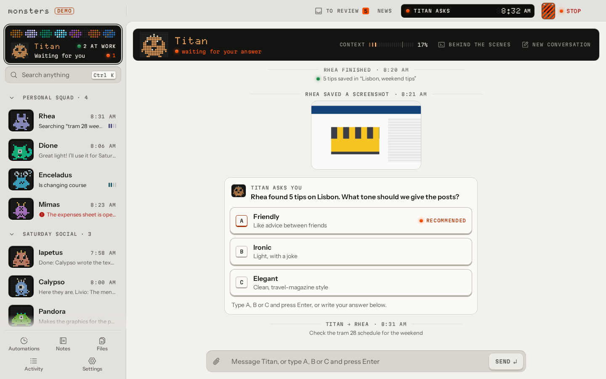
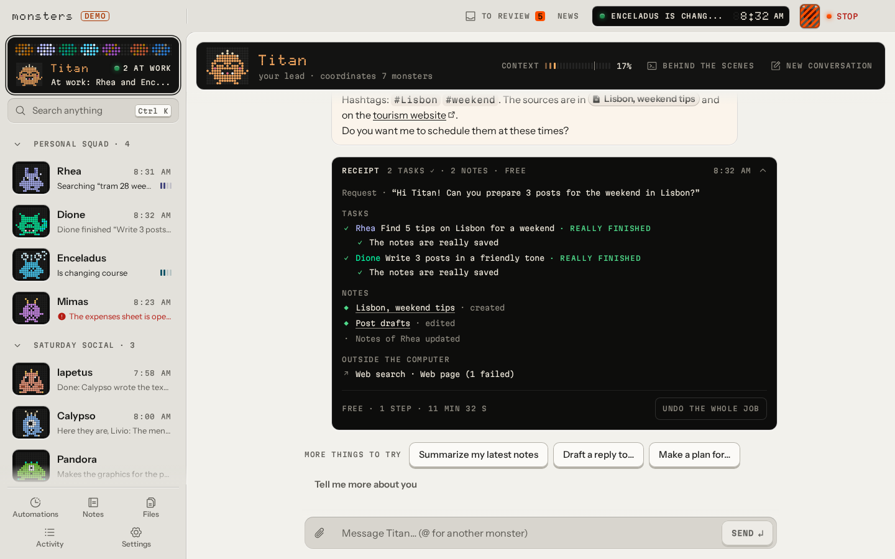
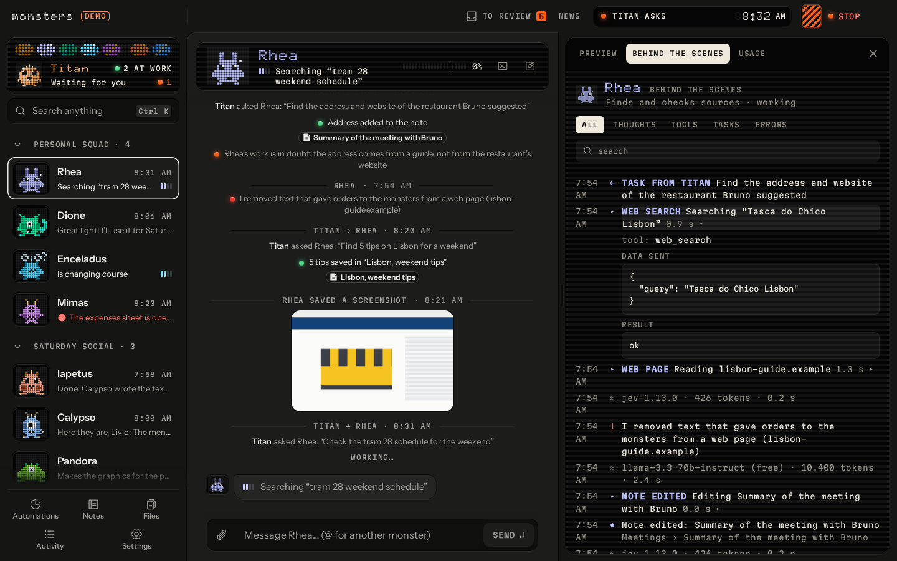
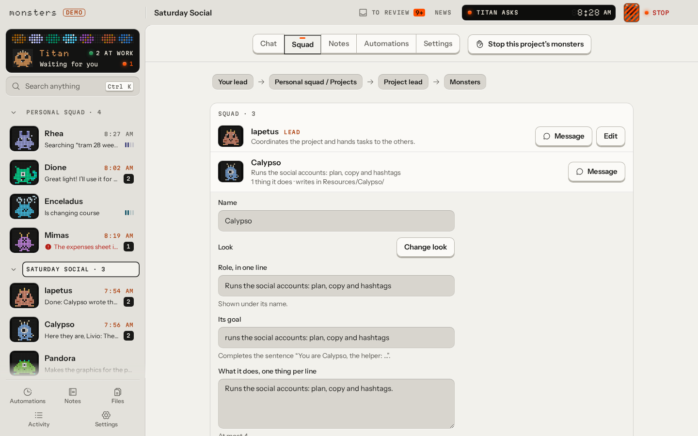

# Monsters

*Italiano: [README.it.md](README.it.md)*

**A local-first, provider-agnostic agentic hub: a squad of small AI agents ("monsters") that work on your own computer.**

You talk to your lead; it hands work to the other monsters, asks you when a choice is yours, and gives you back a
receipt you can undo. Every monster has its own chat, its own "behind the scenes" view, permissions and models. Their
knowledge lives in an Obsidian-compatible Markdown folder where every change is a git commit, everything they do lands
in Activity, and one **Stop** key halts all work at once. It is a desktop app for Linux, Windows and macOS, and you
bring your own models: free ones through OpenRouter, the Claude or ChatGPT plan you already pay for, API keys, or
local models.

Website: <https://getmonsters.dev>



| The receipt of a finished job | Behind the scenes of a monster |
|---|---|
|  |  |



## Status

**Alpha, version 0.1.0-alpha.25** (26 October 2026). It works and is used every day, but expect rough edges and
changes. What changed in each version is in [`CHANGELOG.md`](CHANGELOG.md); where it is going is in
[`docs/ROADMAP.md`](docs/ROADMAP.md).

## Features

- **A squad, not a chatbot.** Your lead plans the work, delegates it to the other monsters in parallel and checks that
  it is really done. It asks you with 2-4 options (one recommended) only when the choice is yours, and proposes whole
  projects and automations as drafts under **To review**: nothing exists until you confirm it.
- **A first start in four screens.** Account, model, your name, then the squad with one "Looks good". Your work, tone
  and writing language come later, in a skippable "Tell me more about you" card.
- **Projects and automations.** A project is created with just its name and has its own lead, monsters, notes,
  folder, apps and spending cap, in five tabs (Chat, Squad, Notes, Automations, Settings). Automations run on a
  schedule, such as "every Sunday night, next week's posts".
- **Any model.** OpenRouter (free models to start), Anthropic, OpenAI, Google, Mistral and Groq with your own keys,
  Ollama and LM Studio locally. Each monster has a main model and a fallback; per-monster chains and Quick / Balanced
  / Thorough tiers are under Advanced.
- **Plans you already have.** Your Claude plan through Claude Code on your computer, and ChatGPT Plus/Pro, also
  through Codex, with the fixed instructions read from the prompt cache so a plan lasts longer. See
  [`docs/subscriptions.md`](docs/subscriptions.md).
- **Apps.** Connect GitHub, Notion, Linear, Google, Slack or any MCP app from a searchable gallery: every connected
  app reaches every monster and project (unless you turn it off for one), and the monsters know all of its tools at
  once. Ordinary writes just happen; deleting, sending, publishing and paying always ask first. A browser with a
  profile separate from yours is included.
- **Answers you can read at a glance.** Key numbers, tables, bar, line and donut charts, comparisons and checklists
  drawn right in the chat, with suggested replies you send in one tap (keys under the message on Telegram).
- **Notes compatible with Obsidian.** Markdown with YAML frontmatter and wikilinks; list, graph, one search box over
  keywords and meaning, backlinks, history and trash. Every edit by a monster is a git commit you can undo, one note
  or a whole job at a time. `monsters mcp` exposes the notes to Claude Desktop, Codex or Cursor with a monster's
  permissions ([`docs/mcp-vault.md`](docs/mcp-vault.md)).
- **Monsters' decisions.** A small, fast model ("the instinct", Basic or Smarter) decides whether to ask you
  something, checks that work is really finished, notices monsters going in circles, brakes actions that leave the
  computer, and strips instructions aimed at the monsters out of web pages and other outside text.
- **Remote.** Telegram from your phone (with dedicated bots per monster for groups), or the terminal chat over SSH
  (`monsters chat`); the desktop app can also connect to Monsters running on another computer through an SSH tunnel.
  See [`docs/remote.md`](docs/remote.md).
- **Control.** Activity records everything; spending caps in euros per day and per month (per project too) plus a
  Careful / Normal / Generous safety net for each job; the **Stop** key; keys in the system keychain. A job stopped at
  a limit writes its report first and says which limit stopped it.

## Download

Get the latest build from [GitHub Releases](https://github.com/Saturday-Company/monsters/releases) or from
<https://getmonsters.dev>:

- **Linux:** AppImage or `.deb`
- **macOS:** `.dmg` for Apple silicon (arm64) or Intel (x64), signed and notarized
- **Windows:** `.exe` installer. It is **not yet signed with a certificate from a public CA**, so Windows SmartScreen
  will warn you. Updates are still verified: the app updates itself from a feed whose manifests are signed with the
  project's update key.

Installed apps update automatically from the signed feed. See [`docs/signing.md`](docs/signing.md).

## Build from source

Requirements: **Node.js 24** or newer and **pnpm 12** (`corepack enable` picks the pnpm version in `package.json`;
it does not change your Node version). About 1 GB of disk space, most of it dependencies and the local embedding
model. Optional: Chrome for the monsters' browser, Claude Code for your Claude plan, Codex for your ChatGPT plan.

```sh
pnpm install
pnpm build:core                                   # web UI + bundled core
pnpm --filter @monsters/cli exec monsters start   # Monsters at http://127.0.0.1:4747
pnpm desktop:dev                                  # or run the Electron desktop app
```

`monsters start` prints the address to open, the data folder and the notes folder, and a one-time **setup code** for
creating your account. It listens only on `127.0.0.1`; to reach it from another machine use an SSH tunnel. The first
start asks how to reach a model: your Claude plan, your ChatGPT plan, or free models with an
[OpenRouter](https://openrouter.ai/keys) key. Other accounts are added later in **Settings → Models**.

Data lives in `~/.monsters` (or `MONSTERS_HOME`), the notes in `~/Monsters Notes` (`~/Monsters Note` for an install
that started in Italian). Without a system keychain, start with `MONSTERS_SECRETS=file`. The Stop key from another
terminal: `monsters kill` (and `monsters resume`, `monsters status`).

For development: `pnpm typecheck && pnpm lint && pnpm test`. [`AGENTS.md`](AGENTS.md) has every command, the
conventions and the checklist before a pull request.

## Repository layout

| Folder | What it is |
|---|---|
| [`apps/desktop`](apps/desktop) | The Electron app: Monsters in a utility process, the UI in a hardened window, updates |
| [`apps/web`](apps/web) | The interface: chats, behind the scenes, notes, Activity, settings |
| [`apps/site`](apps/site) | The website, getmonsters.dev (Astro) |
| [`apps/update-server`](apps/update-server) | The update feed (a Cloudflare Worker) |
| [`packages/core`](packages/core) | The core: agents, lead and delegation, event log, Stop, local server |
| [`packages/providers`](packages/providers) | Model providers, fallbacks, plans and rate budgets |
| [`packages/vault`](packages/vault) | The notes: Markdown, SQLite index, search, git history |
| [`packages/tools`](packages/tools) | Built-in tools such as web search and web fetch |
| [`packages/cli`](packages/cli) | The `monsters` command |
| [`packages/remote`](packages/remote) | Client mode over SSH |
| [`packages/monster-kit`](packages/monster-kit) | The monsters' looks: a parametric SVG kit |
| [`packages/db`](packages/db), [`packages/shared`](packages/shared) | SQLite with namespaced migrations; shared schemas and types |

## Documentation

The guides, the community files (README, CONTRIBUTING, SECURITY, AGENTS) and the code are in English. Only
`docs/DECISIONS.md`, `docs/research/` and `docs/eval/` are an Italian archive (new decisions are written in English).

- [`docs/ARCHITECTURE.md`](docs/ARCHITECTURE.md): how it is built
- [`docs/DECISIONS.md`](docs/DECISIONS.md): every non-obvious technical decision, with context and rationale
- [`docs/ROADMAP.md`](docs/ROADMAP.md): phases and direction
- [`docs/security-model.md`](docs/security-model.md): threat model and defenses
- [`docs/remote.md`](docs/remote.md): Telegram and SSH
- [`docs/subscriptions.md`](docs/subscriptions.md): using Claude and ChatGPT plans
- [`docs/mcp-vault.md`](docs/mcp-vault.md): the notes as an MCP server
- [`docs/design.md`](docs/design.md): the visual direction and the glossary of the interface
- [`docs/i18n.md`](docs/i18n.md): English and Italian dictionaries
- [`docs/signing.md`](docs/signing.md): packaging, signing and updates
- [`docs/ci.md`](docs/ci.md): continuous integration

## Contributing

Contributions are welcome. Read [`CONTRIBUTING.md`](CONTRIBUTING.md) (contributions are signed off under the
[DCO](https://developercertificate.org/)), the [`CODE_OF_CONDUCT.md`](CODE_OF_CONDUCT.md) and [`AGENTS.md`](AGENTS.md),
the guide for people and coding agents working on the code. Questions and ideas go to
[Discussions](https://github.com/Saturday-Company/monsters/discussions), bugs to
[Issues](https://github.com/Saturday-Company/monsters/issues). To report a vulnerability, see
[`SECURITY.md`](SECURITY.md).

## License

[Apache-2.0](LICENSE); see also [`NOTICE`](NOTICE). The name "Monsters", the monsters' characters and the logo are
trademarks of Giulio Banchini and Saturday Company: the license does not grant rights to use them, see
[`TRADEMARKS.md`](TRADEMARKS.md).

---

Made by [Saturday Company](https://saturdaycompany.it).
